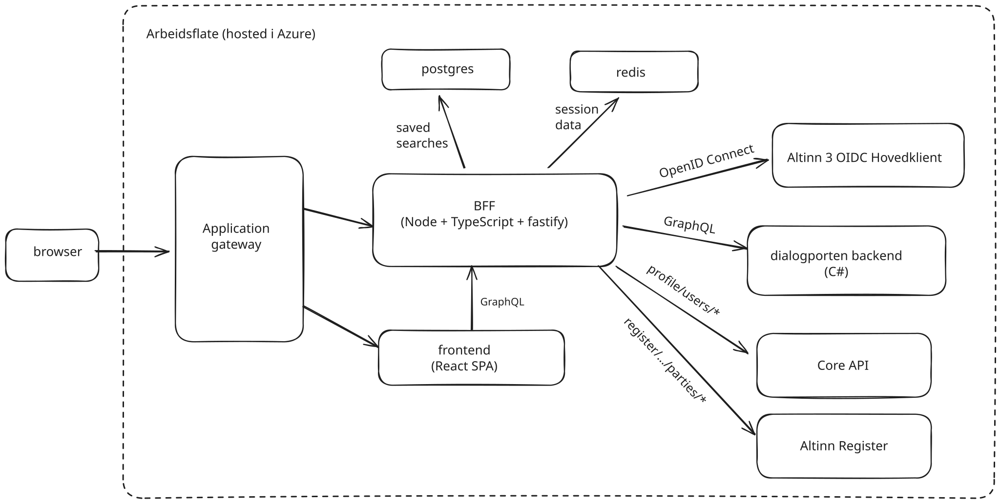

## Components

| Component | Package / location | Role |
| --- | --- | --- |
| Frontend | `packages/frontend` | React SPA (Vite), served by nginx |
| BFF | `packages/bff` | Node/TypeScript/Fastify. Login and sessions, `/api/graphql`, feature flags (`/api/features`) and the alert banner |
| PostgreSQL | TypeORM in `packages/bff` | The BFF's own data: profiles and saved searches |
| Redis | | Sessions, Maskinporten tokens and cached lookups (organizations, service resources) |
| Azure App Configuration | | Feature flags and the alert banner |
| Infrastructure | `.azure/` | Bicep: Container Apps, Application Gateway, Key Vault, Postgres, Redis and more |

## Three ways out of the browser

When something fails, start by finding out which of these paths the request took.

1. **Through the BFF:** `/api/graphql`. The BFF stitches Dialogporten's schema (from the npm package `@digdir/dialogporten-schema`) with its own Nexus schema (see [GraphQL and typegen](../development/graphqltypes/)).
   - Dialogporten fields are forwarded to Dialogporten's GraphQL API with the user's access token.
   - BFF fields are resolved in the BFF against Postgres and Altinn platform APIs (Profile, Register, Correspondence, Notifications, Resource Registry). Some of these use a Maskinporten token instead of the user's token (see [Maskinporten](../notes/maskinporten/maskinporten/)).
   - Person URNs are encrypted on the way out (see [Person URN encryption](../notes/person-urn-encryption/person-urn-encryption/)).
2. **Directly to Dialogporten:** live updates for an open dialog use Server-Sent Events against Dialogporten's `graphql/stream`, authorized with the dialog's `dialogToken` (`useDialogByIdSubscription.ts`).
3. **Directly to the service owner:** main content, transmission content and non-`GET` GUI actions are fetched from the service owner's URLs with the `dialogToken` (see [Dialog anatomy](../notes/presentational-logic/dialog-anatomy/) and [Embeddable content](../notes/presentational-logic/embadable-content/)).

Login and sessions are described in [ID Porten](../notes/id-porten/id-porten/).
