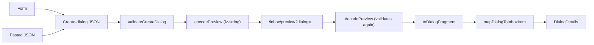

The dialog builder lets testers, developers and service owners create a dialog and see how it looks in Arbeidsflate, without creating anything in Dialogporten. It replaces the manual flow with the ScenarioBuilder HTML file and Postman.

It must never be available in production, or used with real data. See [Security](#security).

## Using it

Open `/dialog-builder`. There is no menu entry.

1. Select the recipient in the party selector in the header.
2. Fill in the form, or paste a dialog as JSON.
3. Fix anything listed under **Resultat**. Clicking an error opens the right section and puts the cursor in the field.
4. Click **Forhåndsvis**, or copy the link to share it.

Navigational actions and transmission attachments are added on each transmission, because that is where the API has them. In the preview they appear when the transmission is expanded.

### What you can paste

- The body of `POST /api/v1/serviceowner/dialogs`.
- The response from `GET /api/v1/serviceowner/dialogs/{dialogId}` or `GET /api/v1/enduser/dialogs/{dialogId}`.
- The response from the `getDialogById` GraphQL query in Arbeidsflate. It has no `serviceResource`, so the builder fills in `urn:altinn:resource:fyll-inn`.

`normalizePastedDialog.ts` converts responses to the POST format. It removes fields that only exist in responses, along with the dialog `id`, so the JSON can create a new dialog. `org` and the resource type are picked up from the response. URLs set to `urn:dialogporten:unauthorized` are kept, so you can preview what a user without access sees, but such a dialog cannot be sent to the API as it is.

**Kopier JSON** gives you a body you can send to the API. If the recipient is a person, replace `party` with the real URN first: the frontend only has the encrypted URN.

## How it works

The preview uses the same `mapDialogToInboxItem` and `DialogDetails` as a real dialog, so it renders the same way.

All the code is in `packages/frontend/src/pages/DialogBuilder`. It is deliberately additive: outside that folder, only `App.tsx` knows about it. `/inbox/preview` is a static route, which React Router ranks above `/inbox/:id`, so the real dialog page is untouched. Prefer keeping it that way over adding preview branches to shared code.

## Differences from a real dialog

- **Actions:** GET actions work as links. All other actions turn into links that do nothing, so nothing is ever sent.
- **Front channel embeds:** never fetched. The URLs are kept in the JSON, but the preview shows no embedded content.
- **Access info and context menu:** not available, since the dialog does not exist.
- **Party:** a dialog is always shown for the selected party. `party` is not part of the link.
- **Person names:** shown exactly as written. Real names from Dialogporten are stored last name first, and the frontend reverses them, but the names here are typed in or already formatted.

## Security

The preview renders content that comes from a URL, so a crafted link is the threat to design against. Anyone can send one.

- **Never in production.** `AVAILABLE_HOSTNAMES` in `availability.ts` is an exact list of hostnames, checked when routes are registered and again when they render. Anything not on the list gets no routes, and the code is never loaded. The JavaScript files are still part of the deployed image, because at23, tt02 and production share a build, but nothing in production can reach them. Do not add a production hostname, or replace the list with a looser check.
- **Nothing is trusted from the link.** The dialog is validated again when it is loaded, and an invalid dialog is not rendered at all. Do not skip this, even if the builder has already validated it.
- **Only `https:` URLs.** `format: uri` in the API specification accepts `javascript:`, so `isHttpsUrl` does the check, and it also rejects URLs with embedded credentials.
- **Text is sanitized.** Plain text is rendered by React, and Markdown goes through the same allowlist as real dialogs, which has no `script`, `img` or `iframe`.
- **No requests based on the link.** Embeds are dropped in `toDialogFragment`, because fetching them would let a link trigger requests from the user's browser, with cookies if the URL is on our own host. Actions that send data do nothing, and no real dialog token exists.
- **No data sent anywhere.** Nothing from the preview is sent to the BFF or to Dialogporten.

Do not paste real dialogs from production into the builder: the link contains the dialog in compressed form, not encrypted.

## Limits

- **Link length:** full page loads fail above about 8 KB, which is the default limit in nginx. That covers reloads, shared links and the redirect after login. **Forhåndsvis** navigates inside the app and works at any size. The builder warns above 7 KB.
- **Link contents:** the dialog is compressed, not encrypted. It appears in gateway logs and in Application Insights page views in test environments. `party` is removed and person identifiers are masked before encoding.
- **Validation:** `dialogSchema.ts` is written by hand from the OpenAPI specification and the main Dialogporten validator. It does not follow API changes automatically, and it does not check maximum lengths. Unknown fields are shown as warnings, so a new API field does not block a preview.

The schema can be compared with `swagger.verified.json` in `@digdir/dialogporten-schema`. Look for `V1ServiceOwnerDialogsCommandsCreate_Dialog`.
