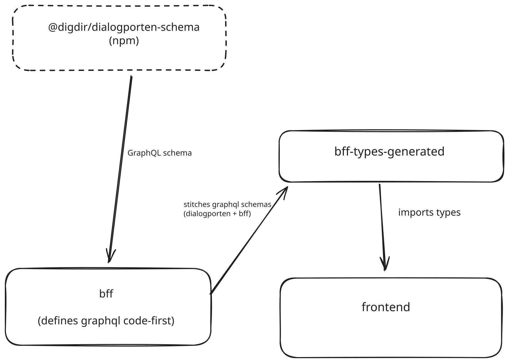

The application uses GraphQL for communication.
The build pipeline goes as follow:

1. The `Dialogporten` project publishes the npm package [@digdir/dialogporten-schma](https://www.npmjs.com/package/@digdir/dialogporten-schema) any time the schema changes. The package includes the raw graphql schema converted into a JavaScript file that exports it as a string and export the from the package.

1. We add the @digdir/dialogporten-schema npm package as a dependency to our project `bff`.

1. In the `bff` application we define our own GraphQL schema code-first, then we [stitch it](https://the-guild.dev/graphql/stitching) together with the schema we get from `Dialogporten`

1. In `bff-types-generated` we import the stitched schema from `bff`

    - Then we define GraphQL queries and fragment queries that the frontend need in `./packages/bff-types-generated/queries`

    - And then generate TypeScript types from the GraphQL schema as well as functions from the GraphQL queries

    - This produces two files: `generated/schema-types.ts`, holding a type for every type in the stitched schema, and `generated/sdk.ts`, holding a type per query/fragment plus the `getSdk()` client. Both are re-exported from the package, so importers see a single flat surface

    - The two files must stay separate. From v6, `typescript-operations` emits its own copy of every enum and input object its queries touch, and only skips this when `importSchemaTypesFrom` points it at another file. Merging them back into one output makes each of those types be declared twice

1. In the `frontend` we import the `bff-types-generated` package and have ready types and functions that we can use in the frontend

## Development

### When `dialogporten` releases new schema versions

1. Update the package version in `@digdir/dialogporten-schema` based on [the newest version](https://www.npmjs.com/package/@digdir/dialogporten-schema?activeTab=versions) in `bff`

1. Check for schema changes using [npmdiff.dev](https://npmdiff.dev/) and see if there is any breaking changes. Look up each change in [Deploy order for schema changes](#deploy-order-for-schema-changes) to see whether we or Dialogporten must deploy first

1. Rebuild the project to ensure that there are no new build problems

### Deploy order for schema changes

The BFF does not fetch Dialogporten's schema at runtime. It stitches the schema from the installed `@digdir/dialogporten-schema` package (`packages/bff/src/graphql/schema.ts`) and forwards queries to the Dialogporten API of its environment. Each side checks the other against its own copy of the schema:

- **The BFF checks every response against our package schema.** A required field can't hold `null`, and an enum value our schema doesn't know turns into `null`. When a required field ends up `null`, the BFF raises an error and the `null` moves up the response to the nearest field that is allowed to be `null`. Everything below that field is dropped, valid data included. In practice that is the whole dialog in `dialogById`, or the whole result list in `searchDialogs` (see [How far a `null` spreads](#how-far-a-null-spreads)). An unknown value in an enum field that allows `null` just comes through as `null`, with no error.

  This only happens once a response actually contains the `null` or the new value, not when Dialogporten deploys. When that starts depends on the data, for example the first service owner to use a new status, so there is no safe window to wait for.
- **Dialogporten checks every query against its live schema.** If we send a field, argument or enum value it doesn't have yet, it rejects the whole request.

Fields that only one side has don't matter as long as we don't query them.

| Change in Dialogporten | Who deploys first | What breaks if the order is wrong |
| --- | --- | --- |
| Required field becomes nullable (e.g. `content` in 1.126.0) | Us | Dialogporten returns `null` where our schema says required, and the `null` [spreads](#how-far-a-null-spreads) to the whole dialog or search result list |
| New value in an output enum (`ActivityType`, `DialogStatus`, `SystemLabel`, …) | Us | The unknown value becomes `null`. On a required enum field that `null` [spreads](#how-far-a-null-spreads) to the whole dialog or search result list |
| Nullable field becomes required | Dialogporten | Our schema says required while Dialogporten can still return `null`, and the `null` [spreads](#how-far-a-null-spreads) to the whole dialog or search result list |
| New field, argument or input enum value | Dialogporten, then we start using it | Dialogporten rejects every request that uses it. Bumping the package without using it is safe |
| Field, argument or input enum value removed | Us: stop using it, then Dialogporten removes it | Dialogporten rejects every request that still uses it |
| Rename | Both, in two steps | Treat it as an addition plus a removal: switch to the new name once Dialogporten has it, then they remove the old one |
| Description or deprecation only | Either | Nothing |

"First" applies to every environment pair, since each of our environments talks to its own Dialogporten environment:

| Our environment | Dialogporten environment | We deploy on |
| --- | --- | --- |
| test | at23 | Every merge to `main` |
| staging | tt02 | Every release |
| yt01 | yt01 | Every release |
| prod | prod | Manual dispatch of a release |

- **We go first:** merge as soon as the package is published. Being ahead of Dialogporten is safe in every environment, so it doesn't matter how far their release has rolled out.
- **Dialogporten goes first:** a merge to `main` reaches test right away, so the change must already be live in at23 before we merge. It must also be live in tt02 and yt01 before we cut a release, and in prod before we deploy that release there.

#### How far a `null` spreads

GraphQL can't return `null` in a required field. Instead, the `null` moves up to the nearest field above it that is allowed to be `null`, and that field becomes `null`. Everything below it is dropped, including data that was valid. That field is often several levels up.

For example, when a transmission's `content` comes back `null` while our schema says it's required:

1. `Transmission.content` is required, so the transmission must become `null`.
1. `transmissions: [Transmission!]!` allows neither `null` entries nor a `null` list, so `Dialog.transmissions` can't take it either, and the dialog must become `null`.
1. `DialogByIdPayload.dialog` is allowed to be `null`, so it stops there.

The response then has an error and no dialog at all. The title, attachments, activities and the other transmissions are gone as well:

```json
{
  "errors": [{ "message": "Cannot return null for non-nullable field Transmission.content." }],
  "data": { "dialogById": { "dialog": null, "errors": [] } }
}
```

Where it stops in our two main queries:

| Bad value in | Stops at | What is lost |
| --- | --- | --- |
| The dialog, or one of its transmissions or activities, in `dialogById` | `dialogById.dialog` | The whole dialog |
| One dialog in `searchDialogs` | `searchDialogs.items` | The whole result list, not just that dialog |


### Caveats

`bff-types-generated` watches its own `queries` folder, so new or edited GraphQL queries rebuild automatically.

It does **not** watch the `bff` schema — `schema.ts` lives at the package root, outside the watched `src/**`. If you change the schema definitions in `bff`, the `bff` itself hot-reloads but the generated types do not; rebuild `bff-types-generated` manually.

`generated/` is not checked in. After switching branches or rebasing, rebuild it with `pnpm --filter bff-types-generated build`.
Otherwise `sdk.ts` can lack operations that the frontend calls, and the hooks fail silently without sending a request.

If a new query returns party or person data, check that person URNs are encrypted in the response (see [Person URN encryption](../../notes/person-urn-encryption/person-urn-encryption/)).

