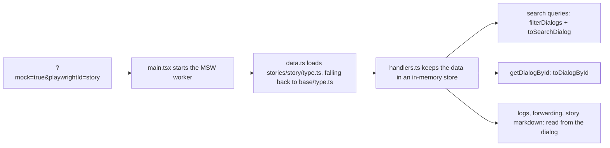

The frontend can run without the BFF. With `?mock=true` in the URL, [MSW](https://mswjs.io/) intercepts every GraphQL request and every request for embedded service owner content, and answers from mock data in `packages/frontend/src/mocks`.
Playwright runs all integration tests this way. You can open the same scenarios by hand under `pnpm dev`.

## Intent

- **One scenario per story.** A story is a folder in `src/mocks/data/stories/`. It gives a test a known set of profile, parties, dialogs and feature flags, and the same data on every run.
- **Base plus overrides.** `src/mocks/data/base/` is a broad default data set. A story only contains the files it changes, so a story shows exactly what is special about its scenario.
- **A dialog is complete where it is defined.** Everything the app can ask about a dialog is on the dialog object: search fields, attachments, activities, transmissions, GUI actions, main content and logs. To change what a dialog shows, you edit the dialog, and nothing else.

Earlier, the dialog page was assembled from the dialog id: helpers in `helper.ts` looked up activities, transmissions, logs and actions with `if (id === …)`. A dialog's content was spread over several files, and the inbox and the dialog page could disagree, for example on the number of attachments.
Do not bring id lookups back. If a scenario needs something special, put it on the dialog.

## How it fits together



1. `src/main.tsx` starts the MSW worker from `src/mocks/browser.ts` when the app runs in dev and the URL has `mock=true`.
2. `src/mocks/data.ts` loads each data type (`profile`, `parties`, `dialogs`, `features`, `searches`, `services`) from `data/stories/<playwrightId>/<type>.ts`. If the story has no such file, it uses `data/base/<type>.ts`. Saved searches default to an empty list, and organizations always come from base.
3. `src/mocks/handlers.ts` puts the data in an in-memory store and answers every request from it:
   - The inbox queries filter the dialogs with `filterDialogs` and return each one through `toSearchDialog`.
   - `getDialogById` returns `toDialogById(dialog)`.
   - Notification logs, the label assignment log, forwarding and story markdown are read from the same dialog.
   - Mutations (system labels, saved searches, profile settings and so on) change the store. The change lasts until the page is loaded again.
4. Embedded content (main content and transmission content) points to `https://dialogporten-serviceprovider.net/fce-*` URLs, and the same handlers answer them.

## The dialog model

A dialog is a `MockDialog`, built with `mockDialog()` from `src/mocks/data/base/mockDialog.ts`. You pass `id` and `content`, plus whatever the scenario needs. Everything else gets the same default for every dialog:

| Field | Default |
| --- | --- |
| Search fields (`party`, `org`, `status`, dates, `endUserContext` …) | Person party `urn:altinn:person:identifier-no:1`, `org: 'ok'`, `RequiresAttention`, `Default` label, seen, `correspondenceservice` |
| `attachments` | One `kvittering.pdf` (`mockAttachment(id)`) |
| `activities` | Dialog created, and one information activity |
| `transmissions` | None. A transmission without `navigationalActions` gets an empty list |
| `guiActions` | An unauthorized "Til skjema" action |
| `additionalInfo` | A standard sentence |
| `mainContentReference` | Markdown main content. Use `mainContentMarkdown` to serve story-specific markdown instead |
| `notificationLogs` | None (`mockNotificationLog()` builds one) |
| `labelAssignmentLog` | Left out: derived from the dialog's system labels |
| `forwarding` | `'allowed'`. Also `'notAllowed'` and `'attachmentsExceedMaxLimit'` |

Some values are derived, so the inbox and the dialog page always agree:

- `guiAttachmentCount` is the number of attachments with a GUI URL.
- The received and sent counts are the transmissions from the service owner and from the party.
- On the dialog page, `isContentSeen` is false while the dialog has the `MarkedAsUnopened` label.

## Adding a scenario

1. Create `src/mocks/data/stories/<my-story>/dialogs.ts`. Each file exports a constant named after the file (`dialogs`, `parties`, `profile` and so on).

   ```ts
   import { ActorType, TransmissionType } from 'bff-types-generated';
   import { dialogs as baseDialogs } from '../../base/dialogs.ts';
   import { type MockDialog, mockDialog } from '../../base/mockDialog.ts';

   export const dialogs: MockDialog[] = [
     mockDialog({
       id: '019241f7-0000-7000-8000-000000000001',
       content: {
         title: { mediaType: 'text/plain', value: [{ value: 'Min dialog', languageCode: 'nb' }] },
         summary: { mediaType: 'text/plain', value: [{ value: 'Kort oppsummering', languageCode: 'nb' }] },
         senderName: null,
         extendedStatus: null,
       },
       attachments: [],
       transmissions: [
         {
           id: 'my-story-t1',
           isAuthorized: true,
           createdAt: '2024-08-15T10:00:00.000Z',
           type: TransmissionType.Information,
           sender: { actorType: ActorType.ServiceOwner, actorId: null, actorName: null },
           relatedTransmissionId: null,
           content: {
             title: { mediaType: 'text/plain', value: [{ value: 'Melding fra etaten', languageCode: 'nb' }] },
             summary: null,
             contentReference: null,
           },
           attachments: [],
         },
       ],
     }),
     ...baseDialogs,
   ];
   ```

   Leave out `...baseDialogs` if the scenario should only contain your own dialogs.
2. Add `parties.ts`, `profile.ts`, `features.ts`, `services.ts` or `searches.ts` only if the scenario needs them.
3. Open the story in a spec with `await page.goto(appUrlWithPlaywrightId('my-story'))` (from `tests/index.ts`).
   By hand, open `http://localhost:5173/?mock=true&playwrightId=my-story` under `pnpm dev`, or `https://app.localhost/?mock=true&playwrightId=my-story` with `make dev`.

## Where things go

- **Attachment:** `attachments`. `mockAttachment(dialogId, index)` gives the standard `kvittering.pdf` / `vedlegg-N.pdf` files. An `expiresAt` in the past gives an expired attachment, and a `url` of `urn:dialogporten:unauthorized` gives one without access. See the `attachment-states` story.
- **Transmission:** `transmissions`. The received and sent counts follow automatically.
- **Transmission button:** `navigationalActions` on the transmission. A `url` of `urn:dialogporten:unauthorized` or `urn:dialogporten:expired` gives a disabled button. See the `transmission-navigational-actions` story.
- **Activity:** `activities`. `activities: []` gives an empty activity log.
- **Notification:** `notificationLogs`, built with `mockNotificationLog(notificationId, overrides)`.
- **Label history:** `labelAssignmentLog`.
- **Action:** `guiActions`.
- **Main content:** `mainContentReference`, with the content helpers in `base/helper.ts`, or `mainContentMarkdown` for text written in the story. `getMockedUnauthorizedFCEContent()` gives content without access, here or as a transmission's `contentReference`. See the `fce-unauthorized` story.
- **Forwarding by email:** `forwarding`. The attachments decide what the forward dialog offers.
- **The same dialog in two stories:** export it from one story and spread it in the other with `mockDialog({ ...otherDialog, ... })`. `activity-history` does this with the dialog from `transmissions`.

See also [Playwright pitfalls](../automatedtests/#playwright-pitfalls), for example why mock pages need the Vite dev server and why `page.reload()` leaves them blank.
