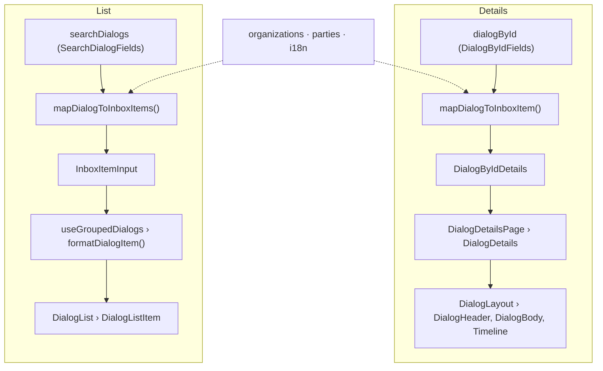

import ListItemAnatomy from '../../../../components/anatomy/ListItemAnatomy.astro';
import DetailsAnatomy from '../../../../components/anatomy/DetailsAnatomy.astro';

The inbox list item and the details page are both built in as components from `@altinn/altinn-components`, and Arbeidsflate maps data from Dialogporten data into their props. This page shows which part of each component is filled by which field, for designers and for developers new to the codebase.

The figures are simplified drawings of the real components. Hover a number to see what it points at, and switch to **Fields** to replace the content with the field that fills it.

## From API to screen

Both views take the same route: a GraphQL query through the BFF, a mapper that turns the response into a small view model, and a props builder that feeds the component. They do not share a data shape. The list asks for a light `SearchDialog` per dialog, and the details page asks for one full `Dialog`.

The mappers look up three things the dialog does not carry itself:

- **`organizations`** gives the service owner's name, logo and contact details, keyed by `org`. The BFF builds it from `altinn-orgs.json` and caches it.
- **`parties`** gives the recipient's name and type, keyed by `party`. These are the parties the user can act for.
- **i18n** picks the language version of each text field and formats dates.

The details page also makes calls of its own:

- `content.mainContentReference`, transmission `contentReference`s and non-`GET` `guiActions` go straight from the browser to the service owner, authorised by `dialogToken`. They do not pass through the BFF. See [Embeddable content](../embadable-content/).
- `notificationLogs` and `labelAssignmentLog` feed the activity log. See [The Activity Log and Its Sources](../activity-log-sources/).
- The `dialogEvents` subscription (SSE) reports changes to the dialog, and the page refetches it. The dialog is also refetched every nine minutes and when the tab regains focus.

## The list item

`DialogListItem`, one per dialog in Innboks, Utkast, Sendt, Arkiv, Papirkurv and search results. The whole card links to `/inbox/{id}/`, except the menu. Its colour follows the recipient: green for a person, blue for an organisation.

<ListItemAnatomy />

### Metadata

| Element | Prop | Field | Rule |
|---|---|---|---|
| Status | `status` | `status` | Hidden for `NOT_APPLICABLE`. `DRAFT` is dotted, `REQUIRES_ATTENTION` is filled, every other status is outlined. |
| Extended status | `extendedStatusLabel` | `content.extendedStatus` | Free text from the service owner, outlined. |
| Last updated | `updatedAt`, `updatedAtLabel` | `contentUpdatedAt` | *9. oktober 2026 kl. 14.03*. Also the sort key and the group key. |
| Attachments | `attachmentsCount` | `guiAttachmentCount` | Shown when above 0. |
| Sent | `sentCount` | `fromPartyTransmissionsCount` | Transmissions from the user. Shown when above 0. |
| Received | `receivedCount` | `fromServiceOwnerTransmissionsCount` | Transmissions from the service owner. Shown when above 0. |
| Due date | `dueAt` | `dueAt`, `status` | Yellow with 14 days or more left. Red with less than 14 days left, or past the date (*Frist utgått: …*). Neutral outline when the status is `COMPLETED` or `AWAITING`. |
| Archive or bin | `archivedAtLabel`, `trashedAtLabel` | `endUserContext.systemLabels` | Shown when the dialog is in the archive or the bin, for example in a search across folders. |

## The details page

`DialogDetails` inside `DialogLayout`, at `/inbox/{id}/`. The header repeats most of the list item. Below it come the content, attachments, actions and transmissions.

<DetailsAnatomy />

### Transmissions

A transmission is a message inside the dialog, from the service owner or from the user. Each one is a row in a `TransmissionList` inside a `TimelineSegment`.

| Part | Field | Rule |
|---|---|---|
| Grouping | `relatedTransmissionId` | Related transmissions share a segment. Newest segment first, and newest transmission first within it. |
| Type badge | `type` | *Informasjon*, *Forespørsel*, *Innsending*, *Rettelse*, *Godkjent*, *Avvist*, *Varsel*, *Avgjørelse*. |
| Title and summary | `content.title`, `content.summary` | Same language rules as the dialog. |
| Byline | `sender`, `createdAt` | *Skatteetaten, 9. oktober 2026 kl. 14.03*. See [Sender Name and Service Owner Logo](../sender-name-and-logo/). |
| Unread | `activities` | Unread until a `TransmissionOpened` activity exists for it. The user's own `SUBMISSION` and `CORRECTION` are never unread. |
| Content | `content.contentReference` | Fetched from the service owner when the transmission is expanded. |
| Attachments | `attachments` | Same rules as the dialog's attachments. |
| Visibility | `isAuthorized`, content | Hidden, disabled or shown with an empty state. See [the visibility table](../activity-log-sources/#2-transmissions). |

## Field map

Every field we ask Dialogporten for, and where it ends up. ● means the view uses it.

| Field | List | Details | Becomes |
|---|:---:|:---:|---|
| `id` | ● | ● | Link to the details page, key for every action |
| `content.title` | ● | ● | Title, and the browser tab title |
| `content.summary` | ● | ● | Summary |
| `content.senderName` | ● | ● | Sender name. Overrides the service owner's name, and hides the logo when the two differ |
| `content.extendedStatus` | ● | ● | Extended status badge |
| `content.mainContentReference` | – | ● | Embedded main content |
| `content.additionalInfo` | – | ● | *Mer informasjon* |
| `org` | ● | ● | Service owner name, logo and contact details from `organizations`. Also used for the delegation link |
| `party` | ● | ● | Recipient name and type from `parties`. Decides the colour |
| `status` | ● | ● | Status badge and due date colour. `DRAFT` also puts the dialog in Utkast |
| `dueAt` | ● | ● | Due date badge |
| `contentUpdatedAt` | ● | ● | *Sist oppdatert*, sorting and month groups |
| `isContentSeen` | ● | ● | Unread badge and bold title. Decides whether the menu offers *Marker som ulest* |
| `hasUnopenedContent` | ● | – | *Ulest innhold* badge |
| `endUserContext.systemLabels` | ● | ● | Folder, folder badge and the move actions in the menu |
| `seenSinceLastContentUpdate` | ● | ● | *Sett av* avatars and dialog |
| `fromPartyTransmissionsCount` | ● | ● | Sent count |
| `fromServiceOwnerTransmissionsCount` | ● | ● | Received count |
| `guiAttachmentCount` | ● | – | Attachment count in the list |
| `attachments` | – | ● | Attachment list, and the attachment count on the details page |
| `guiActions` | – | ● | Action buttons |
| `transmissions` | – | ● | Transmissions and the activity log |
| `activities` | – | ● | Activity log, and unread state of transmissions |
| `dialogToken` | – | ● | Authorises main content, transmission content, actions and live updates |
| `serviceResource` | ● | – | Bankruptcy-estate group at the top of the list |
| `serviceResourceType` | – | ● | Decides whether *Videresend på e-post* is offered |
| `progress` | – | – | Fetched, not shown |
| `createdAt` | – | – | Fetched, not shown |
| `guiActions[].action`, `guiActions[].authorizationAttribute` | – | – | Fetched, not used |

`organizations` also carries the service owner's website, email and phone number. `mapDialogToInboxItem` turns them into contact buttons, but nothing renders them yet.

## Rules that apply to both views

- **Language.** Text fields are lists with one value per language. We use the user's language, then `nb`, then the first value. See `getPreferredPropertyByLocale`.
- **Dates.** Day, month, year and time in the user's language: *9. oktober 2026 kl. 14.03*.
- **Sender, logo and actors.** See [Sender Name and Service Owner Logo](../sender-name-and-logo/).
- **Folders.** `ARCHIVE` puts a dialog in Arkiv and `BIN` in Papirkurv, otherwise it is in Innboks. These three exclude each other. A `DRAFT` status also puts it in Utkast, and a `SENT` label in Sendt. See [How Dialogs Are Organized](../views/).
- **Unread.** A dialog is unread when `isContentSeen` is false. The list also flags `hasUnopenedContent`. A transmission is unread until it has a `TransmissionOpened` activity.
- **Colour.** Green for a person, blue for an organisation. It follows the recipient (`party`), not the sender.

Note: The example dialogs in the figures are made up. The drawings follow altinn-components but are simplified and not pixel-accurate.
