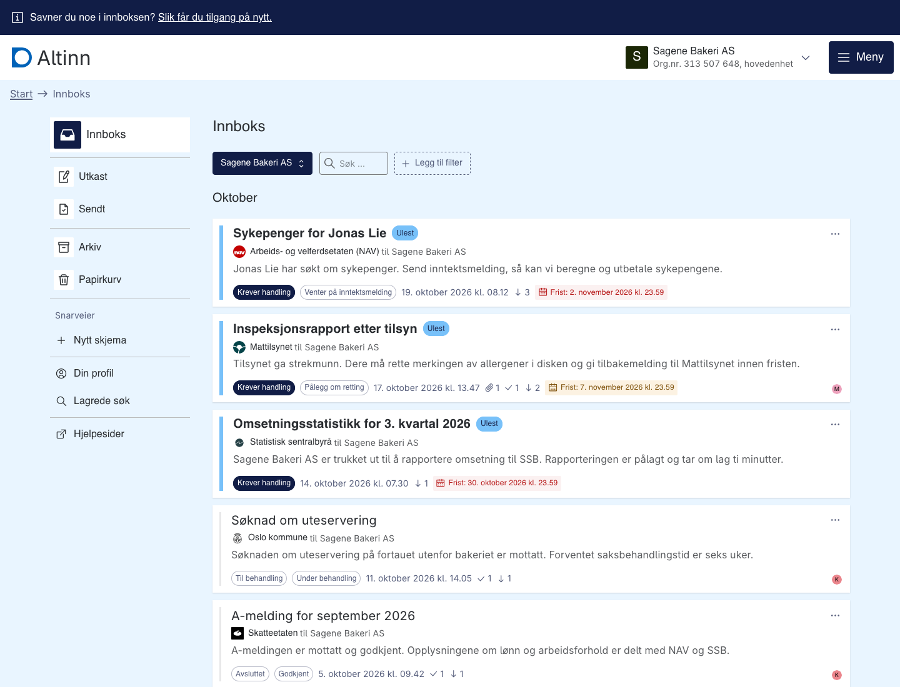
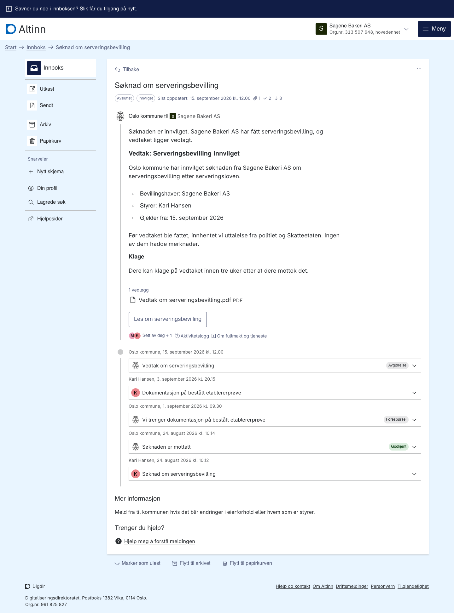

This example shows two things Arbeidsflate is built for:

- **One inbox for many agencies.** Dialogs from seven service owners sit side by side in the same list.
- **One dialog per process.** Each dialog holds the whole case, from application and receipt through requests for information to the decision. It is not a pile of separate messages.

:::caution[Fictional example]
The company, the people, the organisation number and the registration plate are made up: Sagene Bakeri AS (313 507 648), Kari Hansen, Martin Haugen, Jonas Lie and EL 48213. Any likeness to real businesses or people is unintended.

The service owners are real, but the process is fictional. It is meant to be realistic enough to demonstrate the idea, not to describe how each agency's service actually works. The steps are simplified, the texts are written by us and not by the agencies, and the service resource IDs do not exist.
:::

## The story

Kari Hansen is the general manager (daglig leder) of Sagene Bakeri AS, a new bakery and café in Oslo. Martin Haugen chairs the board, and Jonas Lie works there. The inbox follows the business through the life event "starte og drive en bedrift" (starting and running a business), from registration to day-to-day operations.

| # | Service owner | Dialog | Status | What happens in the dialog |
| --- | --- | --- | --- | --- |
| 1 | Brønnøysundregistrene | Registrering av nytt aksjeselskap | Completed | Kari submits Samordnet registermelding. Brønnøysundregistrene asks for a missing signature, Martin sends a corrected founding document, and the company is registered. The VAT part is passed on to Skatteetaten. |
| 2 | Skatteetaten | Registrering i Merverdiavgiftsregisteret | Completed | The application arrives from Brønnøysundregistrene. Skatteetaten asks for documentation, Kari sends the lease and invoices, and the business is registered. |
| 3 | Oslo kommune | Søknad om serveringsbevilling | Completed | Application, receipt, statements from the police and Skatteetaten, a request for the etablererprøve certificate, the reply, and the decision. |
| 4 | Mattilsynet | Inspeksjonsrapport etter tilsyn | Requires attention | Registration of the food business, confirmation, an inspection, and an order to fix allergen labelling with a deadline. |
| 5 | Statens vegvesen | Eierskifte av varebil EL 48213 | Completed | The seller reports a change of ownership, Kari confirms the purchase, and the change is registered. |
| 6 | Skatteetaten | A-melding for *previous month* | Completed | The payroll system submits the a-melding, and Skatteetaten approves it. The data is shared with NAV and SSB. |
| 7 | NAV | Sykepenger for Jonas Lie | Requires attention | Sick note, application for sick pay, and a request for an inntektsmelding with a deadline. |
| 8 | SSB | Omsetningsstatistikk for *previous quarter* | Requires attention | The business has been selected to report turnover. |
| 9 | Oslo kommune | Søknad om uteservering | Awaiting | Application and receipt. The case is being processed. |

Several dialogs refer to each other, which shows the process crossing agency boundaries: Brønnøysundregistrene passes the VAT application to Skatteetaten, Oslo kommune obtains statements from the police and Skatteetaten, and the a-melding is shared with NAV and SSB.

## Screenshots

The inbox for Sagene Bakeri AS. Three dialogs need action and have deadlines. The rest are in progress or completed, and each shows how many transmissions were sent and received.



The serveringsbevilling dialog. The decision is at the top, and the timeline below holds the whole case: application, receipt, request for documentation, reply and decision.



## Open the example

Run `pnpm dev` in `packages/frontend` and open:

```
http://localhost:5173/?mock=true&playwrightId=cross-agency-process&party=urn%3Aaltinn%3Aorganization%3Aidentifier-no%3A313507648
```

The `party` parameter selects Sagene Bakeri AS. Without it the app opens Kari Hansen's personal account, which has no dialogs.

All dates are relative to today, so deadlines stay in the future and the list is grouped into the last few months whenever you open it. The dates in the screenshots above are therefore fixed to the day they were taken.

## How it is built

The dataset lives in `packages/frontend/src/mocks/data/stories/cross-agency-process/`:

| File | Content |
| --- | --- |
| `dialogs.ts` | The nine dialogs as they appear in the list |
| `details.ts` | Transmissions, activities, attachments, actions and main content for each dialog |
| `parties.ts`, `profile.ts` | Kari Hansen and Sagene Bakeri AS |
| `services.ts` | Service resources for the filter |
| `shared.ts` | Actors, dialog IDs, the timeline and date helpers |

Other stories only provide the list data, and the details page falls back to generic test content. A story can also export `details` from a `details.ts` file, keyed by dialog ID (type `MockDialogDetails` in `src/mocks/data/base/helper.ts`). The mock handler then uses those transmissions, activities, attachments and actions, and serves `mainContentMarkdown` as the dialog's main content. Stories without `details.ts` behave as before.

To retake the screenshots, open the URL above in a browser window 1440 pixels wide.
