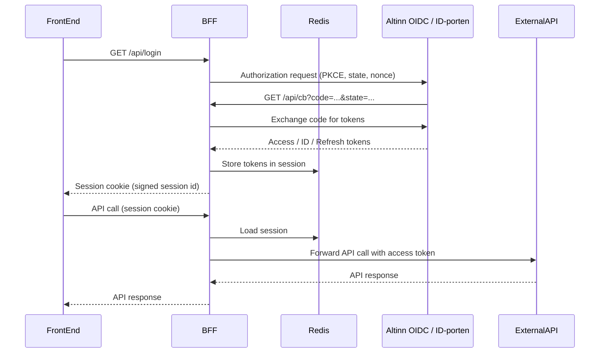

## Login and session management

The BFF logs users in through Altinn's OpenID Connect endpoint (`OIDC_PLATFORM_URL`), which uses ID-porten behind it.
Tokens never reach the browser. The browser only holds a session cookie, and the tokens live in the session in Redis.

<a href='https://docs.digdir.no/docs/idporten/oidc/oidc_func_clientreg.html#metadata-for-klienter-som-konsumerer-apier'>Cf. Doc for more information</a>

### Login (`packages/bff/src/auth/oidc.ts`)

- `/api/login` stores a PKCE code verifier, `state` and `nonce` in the session and redirects to the authorization endpoint.
  It requests `idporten-loa-substantial`, or `idporten-loa-high` when called with `?idporten_loa_high=true`.
- `/api/cb` checks `state` (on mismatch it starts over at `/api/login`), exchanges the code, and checks `nonce` (on mismatch it returns 401).
  It then stores the tokens, `pid` and `locale` in the session. For self-identified users, `pid` falls back to `sub`.

### Session

- The cookie is `arbeidsflate` (`secure`, `httpOnly`, rolling). Its value is the session id signed with `SESSION_SECRET`. It is not encrypted and contains no tokens.
- The session is stored in Redis under `sess:<id>` (`packages/bff/src/auth/sessionStore.ts`).
- When a session is destroyed, the store also writes `sess-revoked:<id>` for two minutes. This stops requests that are still in flight from writing the session back.

### Token refresh

- The frontend polls `/api/isAuthenticated` every 30 seconds (`AuthContext.tsx`) and redirects to `/api/login` when it returns 401.
- **Only `/api/isAuthenticated` refreshes tokens.** It refreshes when the access token expires within 60 seconds and the refresh token is still valid.
- `/api/graphql` never refreshes, except for requests from GraphiQL. The frontend fires many GraphQL requests in parallel, and letting each of them refresh would make them race to use the same refresh token. Keep it this way.
- If the refresh token has expired, or the session has no token, the session is destroyed and the user is logged out.

## Logout and front-channel logout

Logout is done by calling the logout endpoint on id-porten with id token as hint, and a successful logout will redirect to the logged out route on our app.

Our app also supports a route for front-channel logout, which all apps within the circle-of-trust are required to have.
This route destroys the session, provided current session id from id-porten.

At login, the BFF stores `idp-sid:<sid>` → app session id in Redis (8 hours). `/api/frontchannel-logout?iss=...&sid=...` checks the issuer, looks up the app session from `sid` and destroys it.

## Test-only: `/api/init-session`

When `ENABLE_INIT_SESSION_ENDPOINT=true`, `POST /api/init-session` with `{ "token": "<jwt>" }` creates a session directly from an access token and returns the cookie.
The k6 performance tests use it (`packages/frontend/tests/performance/k6/helpers/getCookie.js`).

The endpoint does not validate the token itself; downstream APIs do. It is enabled by default in the Bicep (`main.bicep`) and disabled only in `prod.bicepparam`. It must stay disabled in production.
